<div align="center">


# Clearn

### Clear it. Learn it. Earn it.

**Every lecture, made clear.** Short lessons in simple English and Egyptian Arabic, practice questions that explain
every answer, and a daily plan that learns your pace.

[](https://ziad-alhusseiny.github.io/clearn-landing/)
[](https://ziad-alhusseiny.github.io/clearn-landing/?lang=ar)
[](https://clearn.vercel.app)


<br>

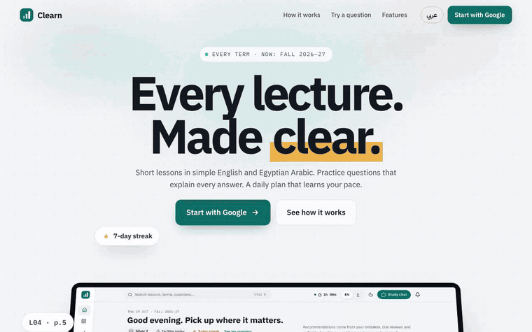

<sub>The real landing page, scrolled — every screen inside it is a real screenshot of the app.</sub>

</div>

---

## Slides are long. Exams come fast.

Clearn turns every lecture into something you can actually finish: **short lessons** (one idea each), **real
practice** that tells you why every option is right or wrong, and **a plan for today** that fits the time you really
have. And every answer shows the slide page it came from, so you never have to wonder if it's true.

<table>
<tr>
<td align="center" width="25%"><h2>2,756</h2>practice questions, with the reason behind every option</td>
<td align="center" width="25%"><h2>341</h2>short lessons in simple English and Egyptian Arabic</td>
<td align="center" width="25%"><h2>1,354</h2>flashcards with spaced review</td>
<td align="center" width="25%"><h2>8</h2>subjects this term, and more lectures on the way</td>
</tr>
</table>

<sub>Fall 2026–27, counted on 29 Oct 2026. The numbers grow with every new lecture.</sub>

## Why students use it

<table>
<tr>
<td width="33%" valign="top">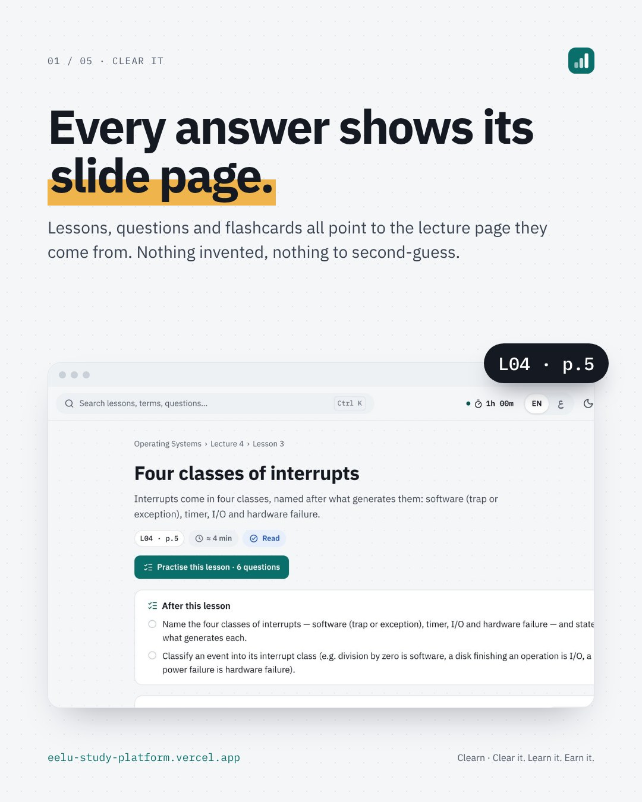<br><b>Trust every answer.</b> Lessons, questions and flashcards carry a chip like <code>L04 · p.5</code>. Tap it and the slide opens.</td>
<td width="33%" valign="top">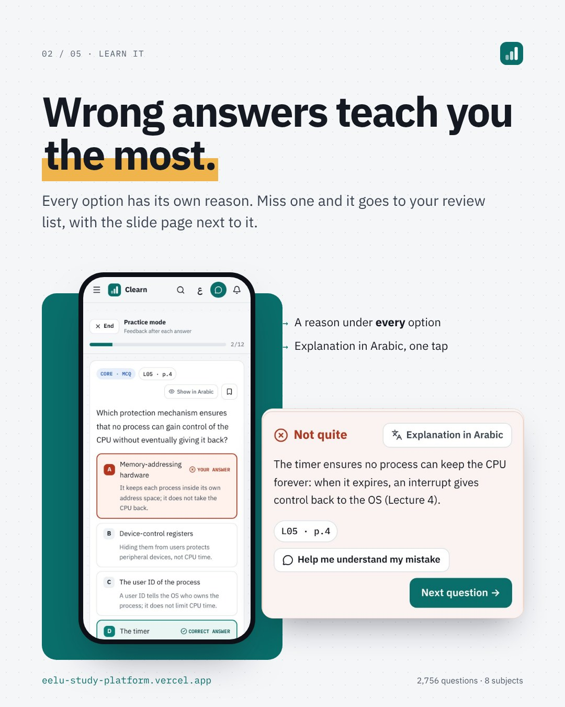<br><b>Wrong answers teach you.</b> Every option has its own reason, with an explanation in Arabic one tap away.</td>
<td width="33%" valign="top">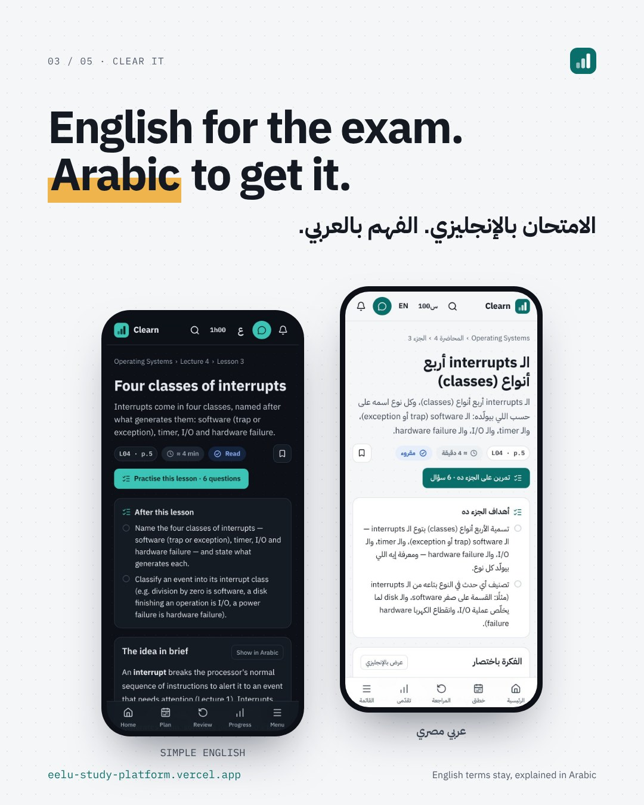<br><b>English for the exam. Arabic to get it.</b> Every lesson in simple English and natural Egyptian Arabic.</td>
</tr>
<tr>
<td width="33%" valign="top">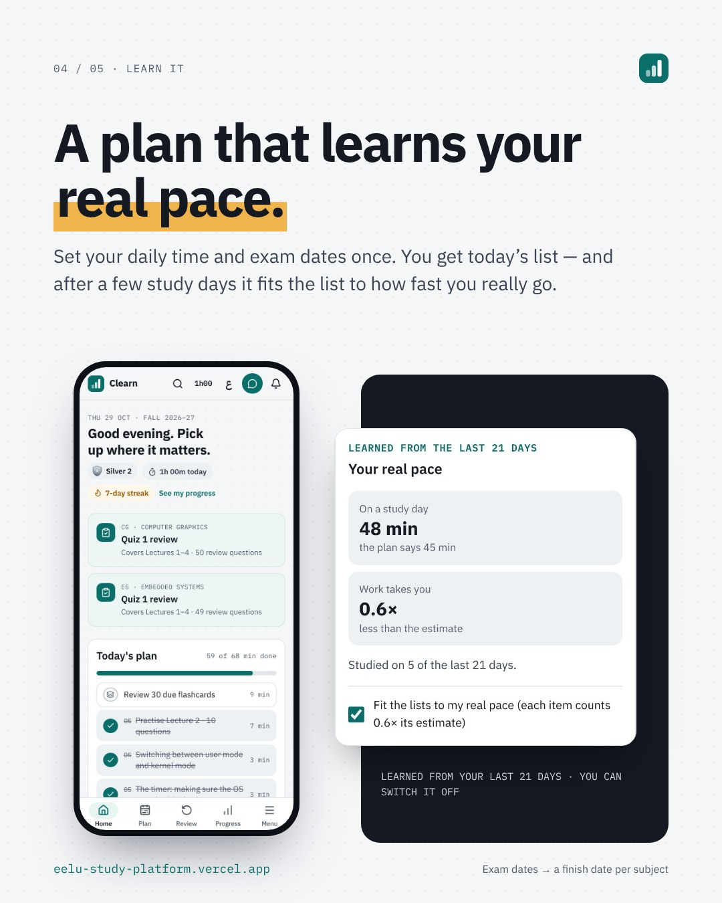<br><b>A plan that learns your pace.</b> Set your daily time and exam dates once; it learns how fast you really go.</td>
<td width="33%" valign="top">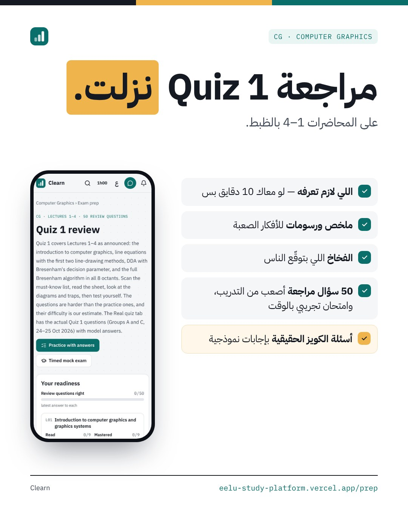<br><b>Exam reviews.</b> A must-know list, the traps, and new harder questions with a timed mock exam.</td>
<td width="33%" valign="top">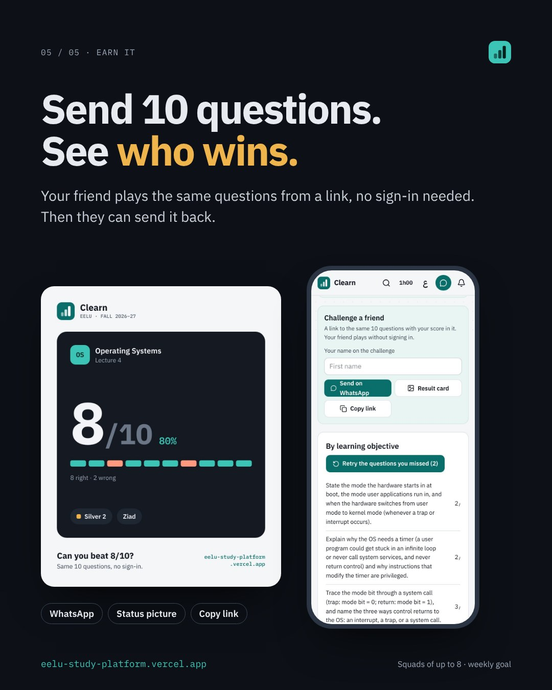<br><b>Challenge a friend.</b> Send 10 questions as a link. They play without signing in, then send one back.</td>
</tr>
</table>

Plus a daily streak, a rank that only goes up, squads of up to 8 with a weekly goal, light and dark mode, and a
result card for your WhatsApp status.

## Made for your phone — and for Arabic

<table>
<tr>
<td width="34%" align="center">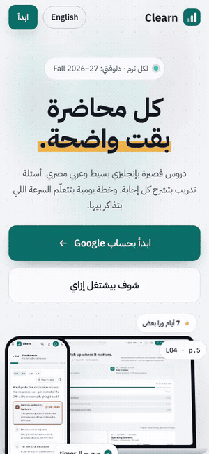</td>
<td valign="middle">

The whole page — and the whole app — switches between **English and عربي** with one tap, right to left included.
Technical terms stay in English and get explained, the way you'll meet them in the exam. Questions stay in English
like the real exam, with a «ترجم» button when you need it.

**Try it:** [ziad-alhusseiny.github.io/clearn-landing/?lang=ar](https://ziad-alhusseiny.github.io/clearn-landing/?lang=ar)

</td>
</tr>
</table>

## Inside the landing page

One page, twelve scenes, all driven by scroll:

| Scene | What happens |
| --- | --- |
| **Hero** | The headline rises word by word, the highlighter sweeps under "clear", and the laptop tilts flat as you scroll. |
| **Subjects** | An endless strip of the term's subjects that speeds up when you scroll fast. |
| **Clear it → Learn it → Earn it** | The section pins; the logo's three bars fill up and the phone screen wipes to each step. |
| **The promise** | One big sentence whose words light up as you read. |
| **Proof** | The browser window tilts up, then zooms right into the `L04 · p.5` source chip. |
| **Try a real question** | A real Operating Systems question: answer it and every option shows its reason. Translate it to Arabic. |
| **The numbers** | Counters run up to the real totals. |
| **Two languages** | Drag (or scroll) the slider from English-light to Arabic-dark on the same screen. |
| **Plan · Exam reviews** | Layers drift at different speeds, steps tick, and a "QUIZ 1" stamp lands. |
| **Phone gallery** | The section pins and the phones slide sideways. |
| **Challenge** | The result card swings flat in 3D. |
| **Final call** | The logo bars rise: *Make it clear.* — «خليها Clear.» |

Built to be fast and fair:

- **Plain HTML, CSS and JavaScript** — no framework, no build step; GitHub Pages serves the files as they are.
- **GSAP + ScrollTrigger** for the animations, **IBM Plex** for the type — both bundled in the repo.
- **Works without JavaScript** and respects **"reduce motion"**: the full content is always there.
- **Keyboard and screen-reader friendly**: real buttons, a live result for the question, a keyboard-controlled slider.
- **Honest by design**: real screenshots and real counts only. No invented users, reviews or numbers.

## The launch kit

The brand and the whole launch campaign were designed in Claude Design before a line of code was written. All
boards are in [`design/launch-kit/`](design/launch-kit/).

<table>
<tr>
<td width="25%">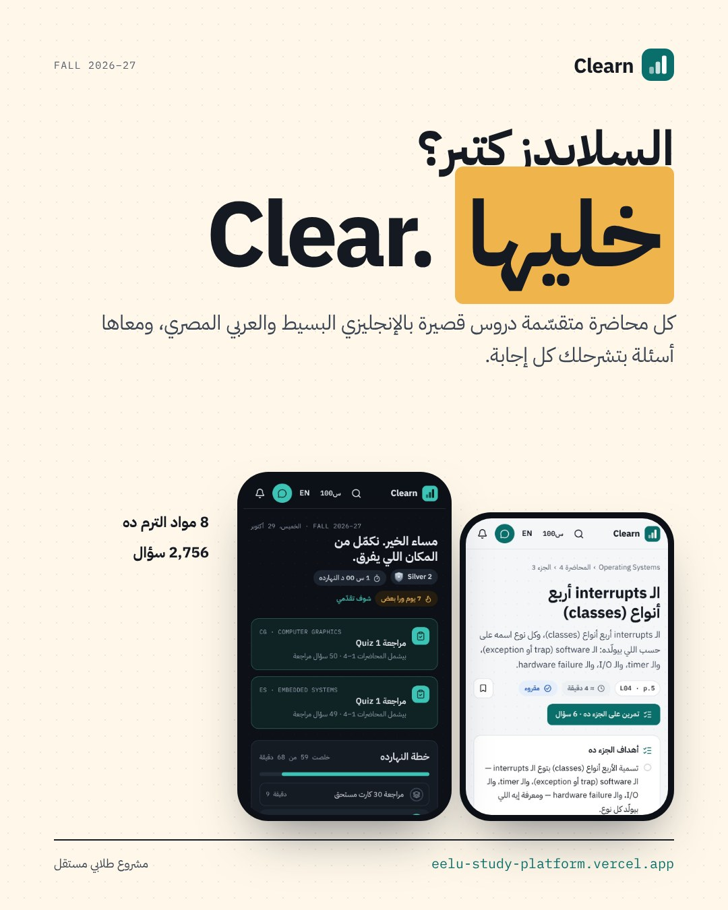</td>
<td width="25%">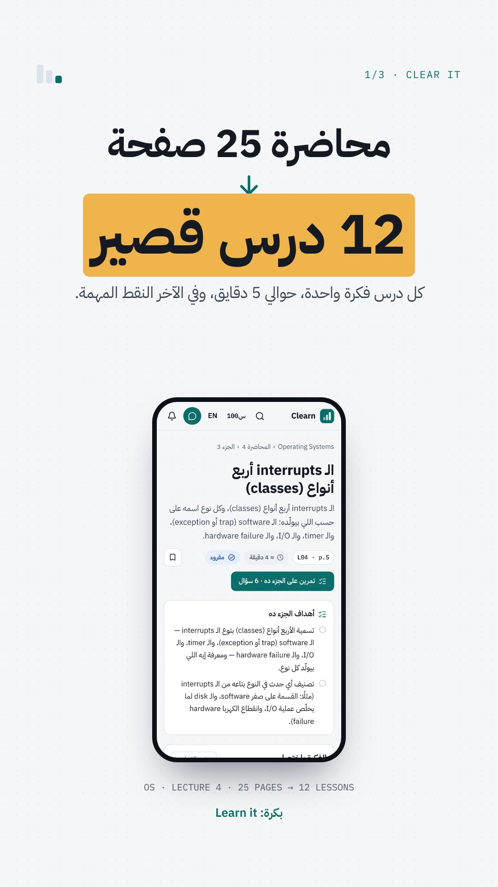</td>
<td width="25%">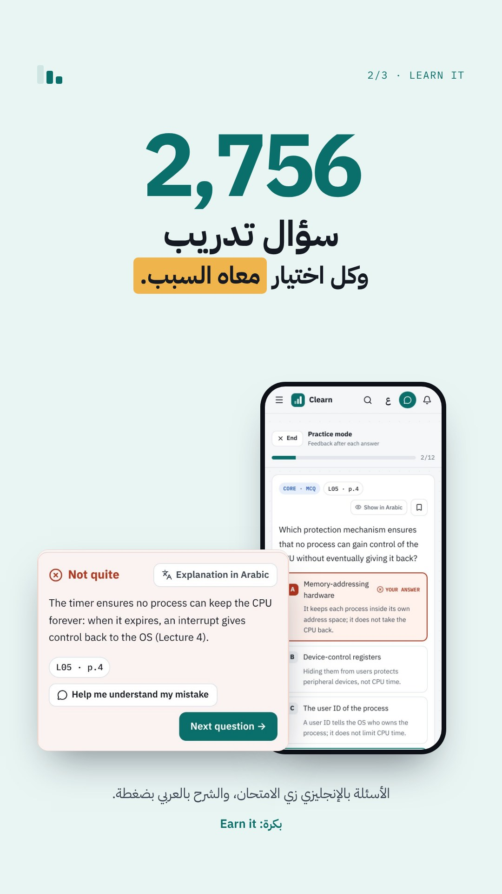</td>
<td width="25%">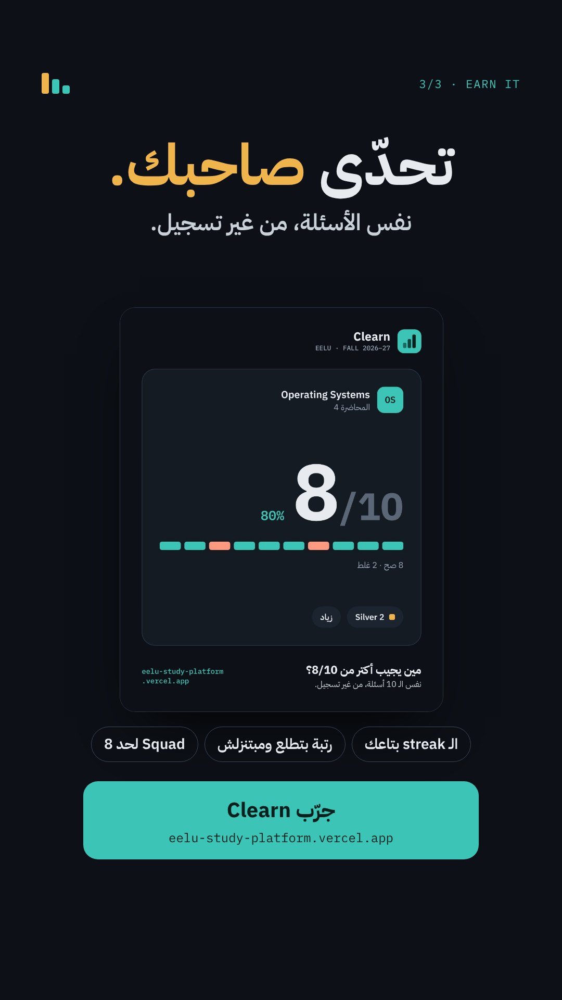</td>
</tr>
</table>

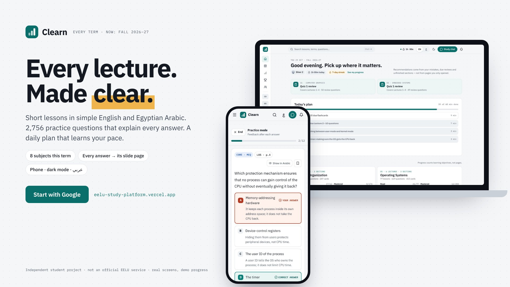

**Brand "Kernel Notebook"** — the app's own look, made into an identity:

| | Colour | Used for |
| --- | --- | --- |
|  | Paper `#F5F6F8` | Dot-grid background |
|  | Ink `#141922` | Text |
|  | Teal `#0A6E6A` | Actions, the logo |
|  | Amber `#F0B44C` | The highlighter |
|  | Night `#0D1117` | Exam-night panels |

The logo's three rising bars **are** the slogan: Clear it · Learn it · Earn it.

## بالعربي

**Clearn — خليها Clear.** كل محاضرة بتتقسم لدروس قصيرة بإنجليزي بسيط وعربي مصري، أسئلة تدريب بتشرح ليه كل
اختيار صح أو غلط، وخطة يومية بتتعلّم السرعة اللي بتذاكر بيها. وكل إجابة معاها صفحة السلايد اللي جاية منها.

[افتح الصفحة بالعربي ←](https://ziad-alhusseiny.github.io/clearn-landing/?lang=ar)

## Run it locally

```bash
python3 -m http.server 8090
```

Then open http://127.0.0.1:8090 (add `?lang=ar` for Arabic). Opening `index.html` straight from the disk works too.

<details>
<summary><b>Files and rules for editing</b></summary>

| File | What it is |
| --- | --- |
| `index.html` | The page. Its English text is also what shows without JavaScript. |
| `i18n.js` | Every string in English and Arabic, plus the live demo question. |
| `styles.css` | The brand styles. `.fx` turns on the layouts the scroll animations need. |
| `main.js` | Language switch, the live question, the compare slider and the GSAP scroll animations. |
| `vendor/` | GSAP 3.14.2 + ScrollTrigger ([GSAP standard licence](https://gsap.com/standard-license), no charge). |
| `fonts/` | IBM Plex Sans, Sans Arabic and Mono (SIL Open Font License, see `fonts/OFL.txt`). |
| `img/` | Real screenshots of the app (the study progress in them is demo data) and `og.jpg` for link previews. |
| `design/launch-kit/` | The Claude Design boards (sources + previews). |

- Real screenshots and real counts only. When the counts change, update `data-count` in `index.html` and the
  `try.p` / `numbers.note` strings in `i18n.js` (with the new date), and the numbers in this README.
- No price claims, no semester number, no university logo; the "independent student project" line stays in the footer.
- No personal contact details (phone numbers, emails) on the page.

</details>

---

<div align="center">

**Developed by [Ziad Al-Husseiny](https://github.com/Ziad-AlHusseiny)**

<sub>Clearn is an independent student project, not an official EELU service. Screens are from the real app; the study
progress in them is demo data.</sub>

</div>
